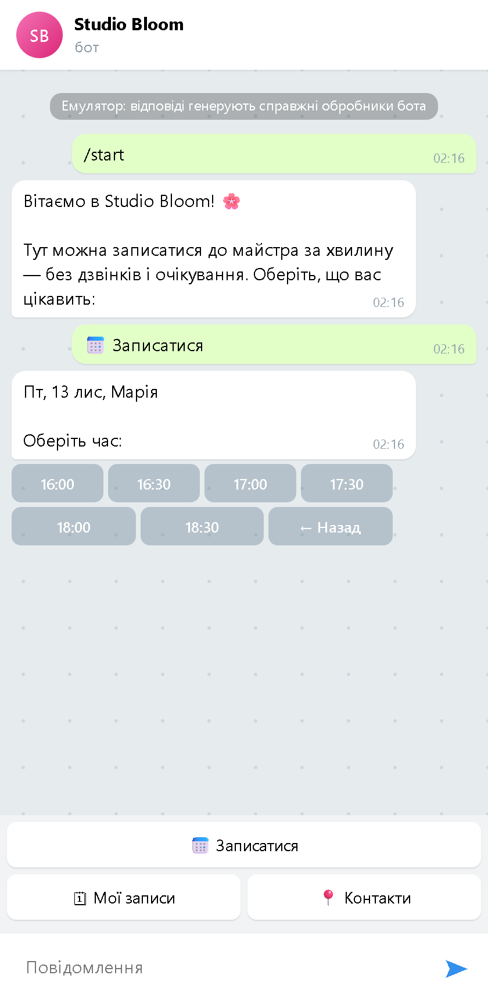
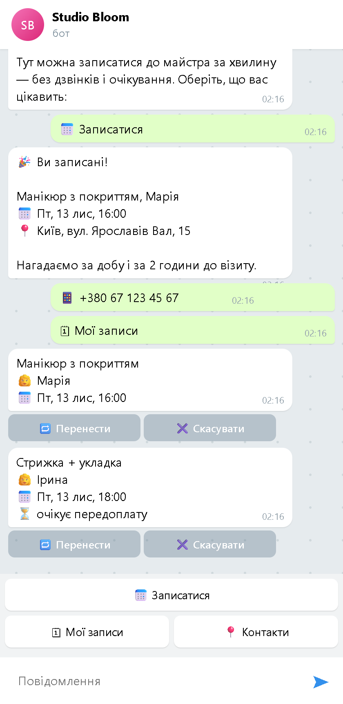
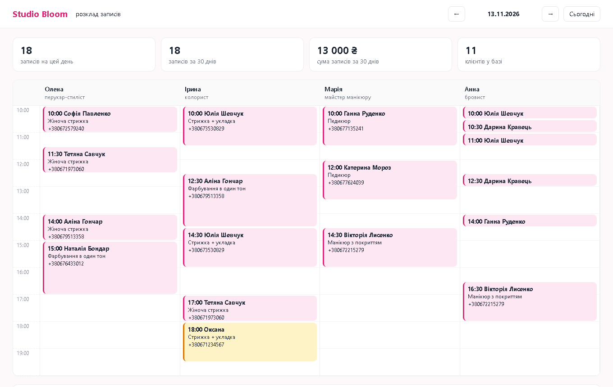

# Telegram-бот онлайн-запису для салону краси

Клієнт записується до майстра кнопками — без дзвінків адміністратору. Бот рахує вільні вікна, нагадує про візит, приймає передоплату і дублює записи в Google Calendar майстра.

| Вибір часу | Запис і «Мої записи» |
| --- | --- |
|  |  |



## Можливості

**Для клієнта**
- Послуга → майстер (або «будь-який вільний» — бот знайде найближче вікно) → день → час → підтвердження
- Номер телефону однією кнопкою «Надіслати номер»
- Вільні слоти рахуються з графіка майстра і тривалості послуги; перед підтвердженням час перевіряється ще раз, щоб двоє людей не забрали одне вікно
- «Мої записи»: перенесення на інший час і скасування кнопками
- Нагадування за добу і за 2 години, з кнопками «Перенести» / «Скасувати»
- Передоплата через LiqPay для дорогих послуг (поріг і відсоток у налаштуваннях); запис підтверджується після callback від LiqPay з перевіркою підпису

**Для салону**
- `/today` — записи на сьогодні по майстрах, `/stats` — статистика за 30 днів, `/broadcast` — розсилка по базі клієнтів (з урахуванням лімітів Telegram)
- Веб-панель: розклад дня по майстрах, сума записів, розсилка
- Синхронізація з Google Calendar кожного майстра (створення, перенесення, видалення подій)

## Стек

Python 3.12, aiogram 3, SQLAlchemy 2 (async), PostgreSQL, Redis (стан діалогів), FastAPI (панель і callback LiqPay), Google Calendar API, Docker.

## Запуск

```bash
cp .env.example .env    # токен бота, ID адміністраторів, ключі LiqPay
docker compose up -d --build
docker compose exec bot python -m bot.seed   # послуги, майстри, графік
```

Без Docker:

```bash
pip install -r requirements.txt
python -m bot.seed
python -m bot.main                              # бот
uvicorn webadmin.app:app --port 8080            # панель
```

## Перевірка без токена

На `http://localhost:8080/dev/chat` є емулятор чату: апдейти йдуть у справжній `Dispatcher` з усіма обробниками, а відповіді бота перехоплюються замість відправки в Telegram. Скріншоти чату вище зроблені саме так.

Тестові записи для панелі: `python scripts/demo_bookings.py`.

## Тести

```bash
pip install -r requirements-dev.txt
pytest -q
```

Розрахунок слотів (зайняті проміжки, тривалість, «не раніше ніж за годину»), підпис LiqPay і повний сценарій запису через обробники бота.

## Структура

```
bot/
  main.py           — запуск, Dispatcher, нагадування у фоні
  handlers/         — booking (сценарій запису), my_bookings, admin
  keyboards.py      — клавіатури і callback data
  services/         — slots, liqpay, gcalendar
  reminders.py      — нагадування за 24 і 2 години
  models.py, seed.py
webadmin/           — панель, callback LiqPay, емулятор чату
```
